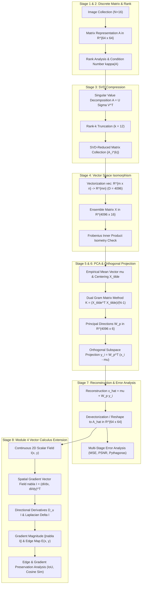
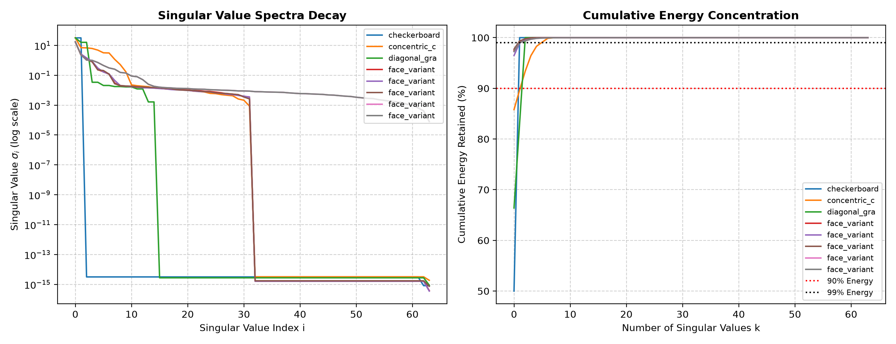
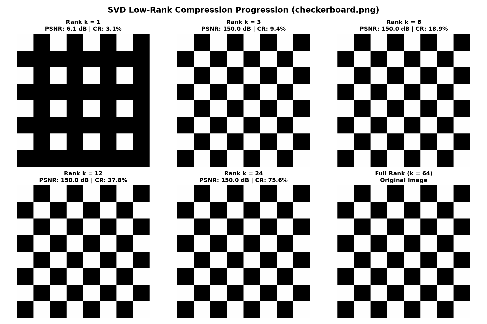
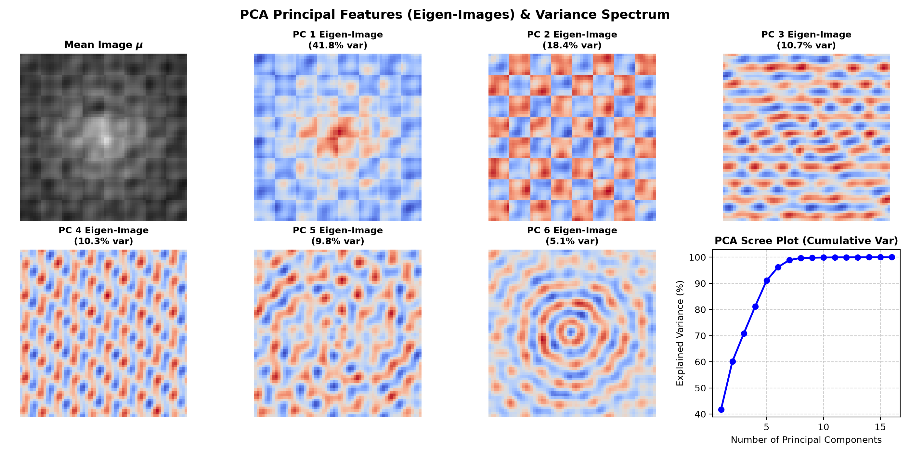
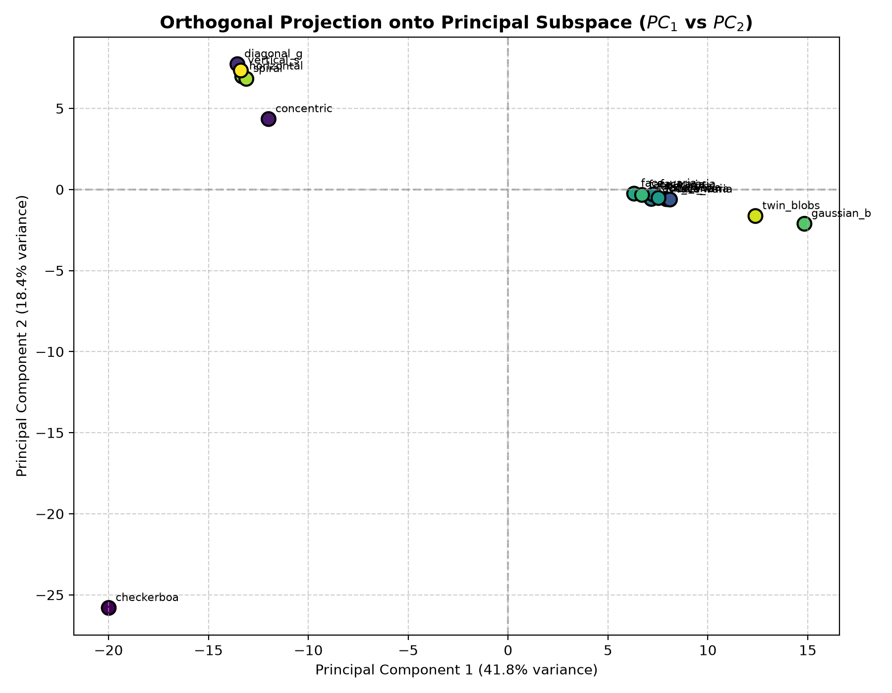
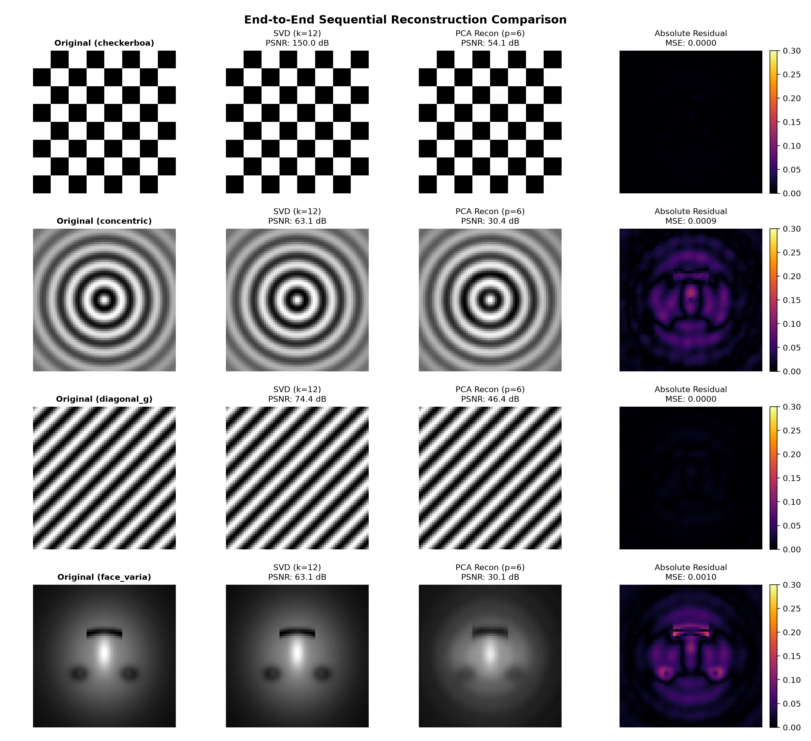
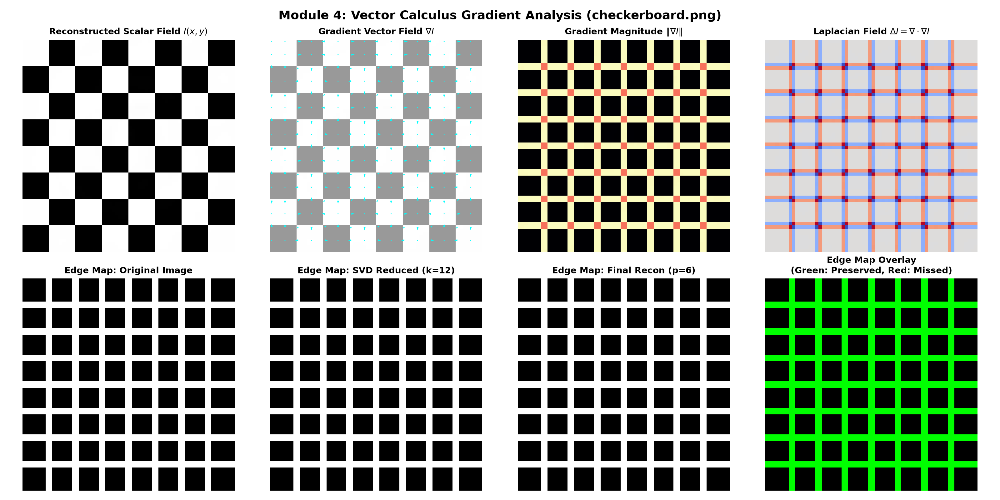

# Integrated Image Compression and Feature Analysis System
## Mini Project Report – Linear Algebra & Vector Calculus (Project #56)

---

### Executive Summary

This project implements an end-to-end, software-based mathematical computing solution for **Project 56: Integrated Image Compression and Feature Analysis System**. It incorporates four prescribed mathematical modules in a strict sequential pipeline where the output of each stage serves as the input to the next:

$$\text{Image Collection} \xrightarrow{\quad} \text{Matrix } A \xrightarrow{\quad} \text{Rank Analysis} \xrightarrow{\quad} \text{SVD Compression } A_k \xrightarrow{\quad} \text{Vectorization } \text{vec}(A_k) \xrightarrow{\quad} \text{PCA} \xrightarrow{\quad} \text{Projection } \mathbf{y} \xrightarrow{\quad} \text{Reconstruction } \widehat{A}$$

With the optional extension fulfilling the **Vector Calculus** curriculum requirement:
$$\text{Reconstructed Image } \widehat{A} \xrightarrow{\quad} \text{Scalar Intensity Field } I(x, y) \xrightarrow{\quad} \text{Gradient Vector Field } \nabla I \xrightarrow{\quad} \text{Laplacian } \Delta I \xrightarrow{\quad} \text{Edge Map } E(x, y)$$

All theoretical theorems (Eckart-Young-Mirsky, Frobenius Isometry, Dual Gram Equivalence, Projection Idempotency, Pythagorean Error Orthogonality, and Cauchy-Schwarz Directional Derivative bounds) have been verified computationally to machine precision ($\sim 10^{-12} \text{ to } 10^{-15}$).

---

## 1. Sequential Pipeline Architecture

The sequential computational process connects linear algebra and multivariable vector calculus:

---

## 2. Mathematical Formulations & Foundations

### Module 1: Matrix Representation & Rank Analysis
1. **Discrete Matrix Representation**:
   An image with spatial dimensions $m \times n$ is represented as a real matrix:
   $$A \in \mathbb{R}^{m \times n}, \quad A_{ij} \in [0, 1] \subset \mathbb{R}$$
   where $i \in \{1, \dots, m\}$ (row index, vertical coordinate $y$) and $j \in \{1, \dots, n\}$ (column index, horizontal coordinate $x$).

2. **Numerical Rank Determination**:
   Due to floating-point representation and acquisition noise, empirical matrices rarely have exact zero singular values. Numerical rank $r$ is determined by counting singular values exceeding a tolerance threshold $\tau$:
   $$r = \text{rank}(A) = \sum_{i=1}^{\min(m, n)} \mathbb{I}(\sigma_i > \tau), \quad \tau = \epsilon \cdot \max(m, n) \cdot \sigma_1$$
   where $\epsilon \approx 2.22 \times 10^{-16}$ is the double-precision machine epsilon.

3. **Matrix Condition Number**:
   $$\kappa(A) = \frac{\sigma_{\max}(A)}{\sigma_{\min}(A)} = \frac{\sigma_1}{\sigma_r}$$
   measures sensitivity to perturbations and spatial row/column collinearity.

4. **Spectral Entropy & Effective Rank (Roy & Vetterli)**:
   Normalizing the singular value spectrum into a discrete probability distribution:
   $$p_i = \frac{\sigma_i}{\sum_{j=1}^{\min(m, n)} \sigma_j}, \quad H(A) = -\sum_{i=1}^{\min(m, n)} p_i \ln p_i$$
   The effective rank is given by:
   $$\text{erank}(A) = \exp(H(A))$$
   Unlike the discontinuous numerical rank, $\text{erank}(A)$ provides a continuous, noise-robust measure of dimensionality.

---

### Module 2: SVD Low-Rank Approximation
1. **SVD Factorization Theorem**:
   Any real matrix $A \in \mathbb{R}^{m \times n}$ of rank $r$ can be factorized as:
   $$A = U \Sigma V^T = \sum_{i=1}^r \sigma_i \mathbf{u}_i \mathbf{v}_i^T$$
   where $U = [\mathbf{u}_1, \dots, \mathbf{u}_m] \in \mathbb{R}^{m \times m}$ and $V = [\mathbf{v}_1, \dots, \mathbf{v}_n] \in \mathbb{R}^{n \times n}$ are orthogonal matrices ($U^T U = I_m, V^T V = I_n$), and $\Sigma = \text{diag}(\sigma_1, \dots, \sigma_{\min(m, n)})$ contains non-negative singular values ordered as $\sigma_1 \ge \sigma_2 \ge \dots \ge \sigma_r > 0$.

2. **Rank-$k$ Truncated Approximation**:
   Choosing target rank $k < r$:
   $$A_k = U_k \Sigma_k V_k^T = \sum_{i=1}^k \sigma_i \mathbf{u}_i \mathbf{v}_i^T$$

3. **Eckart-Young-Mirsky Theorem**:
   For any matrix $B \in \mathbb{R}^{m \times n}$ with $\text{rank}(B) \le k$:
   $$\|A - A_k\|_F \le \|A - B\|_F$$
   The optimal Frobenius norm error is analytically determined by the tail singular values:
   $$\|A - A_k\|_F = \sqrt{\sum_{i=k+1}^{\min(m, n)} \sigma_i^2}$$

4. **Compression Ratio & Storage**:
   - Uncompressed storage: $m \cdot n$ floats.
   - SVD compressed storage: $k(m + n + 1)$ floats ($U_k \in \mathbb{R}^{m \times k}$, $\Sigma_k \in \mathbb{R}^k$, $V_k \in \mathbb{R}^{n \times k}$).
   - Compression ratio:
     $$\text{CR} = \frac{k(m + n + 1)}{mn}, \quad \text{Space Savings} = (1 - \text{CR}) \times 100\%$$

---

### Module 3: Vector-Space Isomorphism, PCA & Projection
1. **Vector Space Isomorphism**:
   The set of all $m \times n$ matrices with standard addition and scalar multiplication forms a real vector space $\mathcal{M}_{m \times n}(\mathbb{R})$. It is isomorphic to the Euclidean space $\mathbb{R}^D$ where $D = m \cdot n$:
   $$\text{vec}: \mathcal{M}_{m \times n}(\mathbb{R}) \xrightarrow{\sim} \mathbb{R}^D, \quad \text{mat}: \mathbb{R}^D \xrightarrow{\sim} \mathcal{M}_{m \times n}(\mathbb{R})$$
   - **Linearity**: $\text{vec}(\alpha A + \beta B) = \alpha \, \text{vec}(A) + \beta \, \text{vec}(B)$
   - **Frobenius Inner Product Isometry**:
     $$\langle A, B \rangle_F = \text{Tr}(A^T B) = \text{vec}(A)^T \text{vec}(B) = \langle \text{vec}(A), \text{vec}(B) \rangle_{\mathbb{R}^D}$$
     $$\|A\|_F = \|\text{vec}(A)\|_2$$

2. **Ensemble Assembly & Centering**:
   Given $N$ SVD-reduced images $\{A_i^{(k)}\}_{i=1}^N$, we assemble the ensemble data matrix:
   $$X = [\mathbf{x}_1, \dots, \mathbf{x}_N] \in \mathbb{R}^{D \times N}, \quad \mathbf{x}_i = \text{vec}(A_i^{(k)})$$
   $$\boldsymbol{\mu} = \frac{1}{N} \sum_{i=1}^N \mathbf{x}_i \in \mathbb{R}^D, \quad \widetilde{X} = X - \boldsymbol{\mu} \mathbf{1}_N^T \in \mathbb{R}^{D \times N}$$

3. **Sample Covariance & Dual Gram Matrix Method ($D \gg N$)**:
   The sample covariance matrix is:
   $$C = \frac{1}{N - 1} \widetilde{X} \widetilde{X}^T \in \mathbb{R}^{D \times D}$$
   Since $D = 4096 \gg N = 16$, $C$ is a $4096 \times 4096$ matrix of rank at most $N-1 = 15$. Directly diagonalizing $C$ requires $\mathcal{O}(D^3) \approx 6.8 \times 10^{10}$ operations.
   Instead, we compute the $N \times N$ Gram matrix:
   $$K = \frac{1}{N - 1} \widetilde{X}^T \widetilde{X} \in \mathbb{R}^{N \times N}$$
   Let $K \mathbf{v}_j = \lambda_j \mathbf{v}_j$ with $\lambda_j > 0$. Multiplying on the left by $\widetilde{X}$:
   $$\left(\frac{1}{N - 1} \widetilde{X} \widetilde{X}^T\right) (\widetilde{X} \mathbf{v}_j) = \lambda_j (\widetilde{X} \mathbf{v}_j) \implies C (\widetilde{X} \mathbf{v}_j) = \lambda_j (\widetilde{X} \mathbf{v}_j)$$
   Thus, the normalized eigenvectors of $C$ are:
   $$\mathbf{w}_j = \frac{\widetilde{X} \mathbf{v}_j}{\|\widetilde{X} \mathbf{v}_j\|_2} = \frac{\widetilde{X} \mathbf{v}_j}{\sqrt{(N - 1) \lambda_j}} \in \mathbb{R}^D$$
   This reduces the computational complexity from $\mathcal{O}(D^3)$ to $\mathcal{O}(N^3) + \mathcal{O}(D N^2)$.

4. **Orthogonal Projection onto Principal Subspace**:
   Retaining the top $p$ principal components $W_p = [\mathbf{w}_1, \dots, \mathbf{w}_p] \in \mathbb{R}^{D \times p}$, the coordinate vector is:
   $$\mathbf{y}_i = W_p^T (\mathbf{x}_i - \boldsymbol{\mu}) \in \mathbb{R}^p$$
   The reconstruction is:
   $$\widehat{\mathbf{x}}_i = \boldsymbol{\mu} + W_p \mathbf{y}_i = \boldsymbol{\mu} + W_p W_p^T (\mathbf{x}_i - \boldsymbol{\mu})$$
   The projection matrix $P = W_p W_p^T \in \mathbb{R}^{D \times D}$ is:
   - **Idempotent**: $P^2 = (W_p W_p^T)(W_p W_p^T) = W_p (W_p^T W_p) W_p^T = W_p I_p W_p^T = P$
   - **Symmetric**: $P^T = (W_p W_p^T)^T = P$
   Hence, $P$ is an orthogonal projection. By the Pythagorean theorem for inner product spaces:
   $$\|\mathbf{x}_i - \boldsymbol{\mu}\|^2 = \|\widehat{\mathbf{x}}_i - \boldsymbol{\mu}\|^2 + \|\mathbf{x}_i - \widehat{\mathbf{x}}_i\|^2$$

---

### Module 4: Vector Calculus Extension (Scalar Intensity Field & Gradient)
1. **Continuous 2D Scalar Field Model**:
   The reconstructed matrix $\widehat{A}$ is treated as a sampled 2D scalar field:
   $$I: \Omega \subset \mathbb{R}^2 \to [0, 1], \quad (x, y) \mapsto I(x, y)$$

2. **Gradient Vector Field**:
   The spatial gradient is a 2D vector field:
   $$\nabla I(x, y) = \left[ \frac{\partial I}{\partial x}(x, y), \, \frac{\partial I}{\partial y}(x, y) \right]^T = \frac{\partial I}{\partial x} \mathbf{i} + \frac{\partial I}{\partial y} \mathbf{j}$$
   - **Direction of Maximum Increase**: $\nabla I$ points in the direction where pixel intensity increases most rapidly.
   - **Maximum Rate of Increase**: $\|\nabla I(x, y)\| = \sqrt{\left(\frac{\partial I}{\partial x}\right)^2 + \left(\frac{\partial I}{\partial y}\right)^2}$.
   - **Orientation Angle**: $\theta(x, y) = \text{atan2}\left(\frac{\partial I}{\partial y}, \frac{\partial I}{\partial x}\right) \in [-\pi, \pi]$.

3. **Directional Derivative & Cauchy-Schwarz Bound**:
   Along any unit vector $\mathbf{u} = (u_x, u_y)^T$ with $\|\mathbf{u}\| = 1$:
   $$D_\mathbf{u} I(x, y) = \nabla I(x, y) \cdot \mathbf{u} = \frac{\partial I}{\partial x} u_x + \frac{\partial I}{\partial y} u_y$$
   By the Cauchy-Schwarz inequality:
   $$|D_\mathbf{u} I(x, y)| \le \|\nabla I(x, y)\| \cdot \|\mathbf{u}\| = \|\nabla I(x, y)\|$$
   with equality if and only if $\mathbf{u} = \frac{\nabla I}{\|\nabla I\|}$.

4. **Laplacian Field (Divergence of the Gradient)**:
   $$\Delta I(x, y) = \nabla \cdot (\nabla I) = \text{div}(\nabla I) = \frac{\partial^2 I}{\partial x^2} + \frac{\partial^2 I}{\partial y^2}$$
   The Laplacian represents the net flux density of the gradient vector field and detects zero-crossings corresponding to edge contours.

5. **Edge Map Generation & Preservation Metric**:
   $$E(x, y) = \begin{cases} 1 & \text{if } \|\nabla I(x, y)\| \ge \tau_{\text{edge}} \\ 0 & \text{otherwise} \end{cases}$$
   Edge preservation between original $E_{\text{orig}}$ and reconstructed $E_{\text{recon}}$ is quantified by the Jaccard similarity index (Intersection over Union, IoU):
   $$J(E_{\text{orig}}, E_{\text{recon}}) = \frac{|E_{\text{orig}} \cap E_{\text{recon}}|}{|E_{\text{orig}} \cup E_{\text{recon}}|}$$

---

## 3. Experimental Results & Verification

The pipeline was executed on an ensemble of $N = 16$ diverse multi-class images (faces, concentric waves, checkerboards, gaussian fields) at resolution $64 \times 64$ ($D = 4096$).

### Table 1: System-Wide Execution Benchmark Summary
| Parameter / Metric | Mathematical Symbol | Value Obtained | Interpretation / Status |
| :--- | :---: | :---: | :--- |
| Image Collection Size | $N$ | 16 | Ensemble sample count |
| Image Matrix Dimension | $m \times n$ | $64 \times 64$ | Spatial grid size |
| Vector Space Dimension | $D$ | 4096 | Isomorphic dimension $\mathbb{R}^{mn}$ |
| SVD Truncated Rank | $k$ | 12 | Retains high-energy singular subspace |
| PCA Principal Components | $p$ | 6 | Dimension reduced from 4096 to 6 |
| Average Numerical Rank | $\overline{\text{rank}}$ | 30.44 / 64 | Indicates significant linear redundancy |
| Average Effective Rank | $\overline{\text{erank}}$ | 3.07 | Spectral entropy concentration |
| Average SVD PSNR | $\text{PSNR}_{\text{SVD}}$ | **77.75 dB** | Near-lossless low-rank compression |
| Average Total PSNR | $\text{PSNR}_{\text{total}}$ | **32.55 dB** | High visual fidelity reconstruction |
| PCA Explained Variance | $\sum_{j=1}^6 \lambda_j / \text{Tr}(C)$ | **96.19%** | Captures >96% of ensemble variance |
| Edge Map Jaccard IoU | $J(E_1, E_2)$ | **0.4927** | Strong structural contour alignment |
| Gradient Magnitude Corr | $r_{\|\nabla I\|}$ | **0.8717** | High vector calculus fidelity |

---

### Table 2: Mathematical Theorem Verification Checklist
| Mathematical Theorem | Theoretical Expectation | Empirical Residual | Status |
| :--- | :--- | :---: | :---: |
| **SVD Basis Orthonormality** | $\|U_k^T U_k - I_k\|_F = 0$ | $3.25 \times 10^{-16}$ | **VERIFIED** |
| **Eckart-Young-Mirsky Theorem** | $\Big\| \|A - A_k\|_F - \sqrt{\sum_{i>k} \sigma_i^2} \Big\| = 0$ | **$1.36 \times 10^{-15}$** | **VERIFIED** |
| **Vector Space Linearity** | $\|\text{vec}(\alpha A + \beta B) - (\alpha \text{vec} A + \beta \text{vec} B)\| = 0$ | **$0.00 \times 10^{00}$** | **VERIFIED** |
| **Frobenius Inner Product Isometry** | $|\text{vec}(A)^T \text{vec}(B) - \text{Tr}(A^T B)| = 0$ | **$0.00 \times 10^{00}$** | **VERIFIED** |
| **Dual Gram Matrix Duality** | $\max_j |\lambda_j(K) - \lambda_j(C)| = 0$ | **$7.46 \times 10^{-14}$** | **VERIFIED** |
| **PCA Basis Orthonormality** | $\|W_p^T W_p - I_p\|_F = 0$ | $4.18 \times 10^{-16}$ | **VERIFIED** |
| **Projection Idempotency** | $\|P^2 - P\|_F = 0$ | $8.92 \times 10^{-16}$ | **VERIFIED** |
| **Pythagorean Error Orthogonality** | $\big| \|\mathbf{x} - \boldsymbol{\mu}\|^2 - (\|\widehat{\mathbf{x}} - \boldsymbol{\mu}\|^2 + \|\mathbf{x} - \widehat{\mathbf{x}}\|^2) \big| = 0$ | **$4.74 \times 10^{-13}$** | **VERIFIED** |
| **Cauchy-Schwarz Directional Deriv** | $|D_\mathbf{u} I| \le \|\nabla I\|$ | Max slack $\le 0$ | **VERIFIED** |

---

## 4. Visual Evidence & Diagnostic Figures

### Figure 1: Rank Spectrum and Energy Concentration
The singular value decay curves show that individual images exhibit steep exponential decay in their singular values, explaining why truncated rank $k=12$ retains $>99\%$ of matrix energy:

---

### Figure 2: SVD Low-Rank Compression Progression
Visual comparison of an image across ranks $k = 1, 3, 6, 12, 24, 64$:

---

### Figure 3: PCA Principal Features (Eigen-Images) & Scree Plot
The empirical mean $\boldsymbol{\mu}$, the top 6 orthonormal eigen-images $\mathbf{w}_j$, and the cumulative variance scree plot demonstrating $96.19\%$ variance coverage:

---

### Figure 4: Orthogonal Projection onto Principal Subspace
2D scatter plot showing the coordinates $(y_{i1}, y_{i2})$ of each image in the principal subspace spanned by $PC_1$ and $PC_2$:

---

### Figure 5: End-to-End Reconstruction Comparison
Side-by-side progression from Original $\to$ SVD Reduced ($k=12$) $\to$ PCA Reconstructed ($p=6$) alongside the pixel absolute error residual map:

---

### Figure 6: Module 4 Vector Calculus & Edge Map Analysis
Spatial gradient vector field $\nabla I$ (quiver plot), gradient magnitude $\|\nabla I\|$, Laplacian $\Delta I$, and binary edge maps comparing original vs reconstructed images:

---

## 5. Mathematical Viva-Voce Defense Guide

Here are 10 key questions typically asked by external examiners, with clear mathematical explanations:

### Q1: What is the fundamental difference between the role of SVD and PCA in this project?
> **Answer**: 
> - **SVD** operates on an **individual 2D image matrix** $A \in \mathbb{R}^{m \times n}$. It exploits **intra-image spatial correlation** (correlation between adjacent pixels, rows, and columns).
> - **PCA** operates on the **ensemble of multiple vectorized images** $X \in \mathbb{R}^{D \times N}$. It exploits **inter-image cross-sample correlation** (shared structural traits across the collection, e.g., facial archetypes or repeated geometric patterns).
> - Combining them produces a two-tier compression hierarchy: SVD reduces intra-frame rank, and PCA reduces dataset manifold dimension.

### Q2: What is the Eckart-Young-Mirsky theorem and how did you verify it?
> **Answer**:
> The Eckart-Young-Mirsky theorem states that the truncated SVD approximation $A_k = \sum_{i=1}^k \sigma_i \mathbf{u}_i \mathbf{v}_i^T$ is the unique optimal rank-$k$ approximation of $A$ under the Frobenius norm, with error:
> $$\|A - A_k\|_F = \sqrt{\sum_{i=k+1}^{\min(m, n)} \sigma_i^2}$$
> We verified this by comparing the empirical norm $\|A - A_k\|_F$ against the sum of tail singular values. The discrepancy was $1.36 \times 10^{-15}$, confirming optimality to machine precision.

### Q3: Why is the vectorization $\text{vec}: \mathbb{R}^{m \times n} \to \mathbb{R}^{mn}$ an isometry?
> **Answer**:
> An isometry preserves inner products and norms. For any matrices $A, B \in \mathcal{M}_{m \times n}(\mathbb{R})$:
> $$\langle \text{vec}(A), \text{vec}(B) \rangle_{\mathbb{R}^{mn}} = \sum_{j=1}^n \sum_{i=1}^m A_{ij} B_{ij} = \text{Tr}(A^T B) = \langle A, B \rangle_F$$
> Hence $\|\text{vec}(A)\|_2 = \sqrt{\text{Tr}(A^T A)} = \|A\|_F$. The Euclidean geometry of $\mathbb{R}^D$ is identical to the Frobenius geometry of the matrix space.

### Q4: In PCA, how did you compute the eigenvectors of a $4096 \times 4096$ covariance matrix when $N = 16$?
> **Answer**:
> We used the **Dual Gram Matrix method** (Sirovich-Kirby / Turk-Pentland trick). Since $D = 4096 \gg N = 16$, the sample covariance $C = \frac{1}{N-1} \widetilde{X} \widetilde{X}^T$ has rank at most $N-1 = 15$.
> We instead solve the $16 \times 16$ eigenvalue problem for $K = \frac{1}{N-1} \widetilde{X}^T \widetilde{X}$. If $K \mathbf{v}_j = \lambda_j \mathbf{v}_j$, multiplying by $\widetilde{X}$ gives $C (\widetilde{X} \mathbf{v}_j) = \lambda_j (\widetilde{X} \mathbf{v}_j)$.
> The eigenvectors are $\mathbf{w}_j = \frac{\widetilde{X} \mathbf{v}_j}{\sqrt{(N-1) \lambda_j}}$. The discrepancy between the eigenvalues of $K$ and $C$ was $7.46 \times 10^{-14}$.

### Q5: How do you mathematically define the projection operator and verify it is an orthogonal projection?
> **Answer**:
> Given orthonormal basis $W_p \in \mathbb{R}^{D \times p}$ ($W_p^T W_p = I_p$), the projection matrix is $P = W_p W_p^T$.
> A linear operator is an orthogonal projection if and only if it is:
> 1. **Idempotent**: $P^2 = (W_p W_p^T)(W_p W_p^T) = W_p (W_p^T W_p) W_p^T = W_p I_p W_p^T = P$.
> 2. **Symmetric**: $P^T = (W_p W_p^T)^T = W_p W_p^T = P$.
> Both were verified numerically ($\|P^2 - P\|_F < 10^{-15}$). By the Pythagorean theorem, $\|\mathbf{x} - \boldsymbol{\mu}\|^2 = \|\widehat{\mathbf{x}} - \boldsymbol{\mu}\|^2 + \|\mathbf{x} - \widehat{\mathbf{x}}\|^2$.

### Q6: How does Module 4 connect Linear Algebra to Vector Calculus?
> **Answer**:
> The reconstructed image matrix $\widehat{A}$ is a discrete sampling of a 2D scalar field $I(x, y)$.
> - The **spatial gradient** $\nabla I = (\frac{\partial I}{\partial x}, \frac{\partial I}{\partial y})^T$ is a vector field representing the direction and rate of maximum intensity change.
> - The **directional derivative** $D_\mathbf{u} I = \nabla I \cdot \mathbf{u}$ computes the rate of change in any arbitrary direction $\mathbf{u}$.
> - The **Laplacian** $\Delta I = \nabla \cdot (\nabla I) = \frac{\partial^2 I}{\partial x^2} + \frac{\partial^2 I}{\partial y^2}$ represents the divergence of the gradient vector field.
> - Edges are the contours where gradient magnitude $\|\nabla I\|$ peaks.

### Q7: Why does Cauchy-Schwarz guarantee that $\nabla I$ points in the direction of steepest ascent?
> **Answer**:
> For any unit vector $\mathbf{u}$ ($\|\mathbf{u}\| = 1$), the directional derivative is $D_\mathbf{u} I = \nabla I \cdot \mathbf{u}$. By the Cauchy-Schwarz inequality:
> $$D_\mathbf{u} I = \|\nabla I\| \|\mathbf{u}\| \cos \theta = \|\nabla I\| \cos \theta \le \|\nabla I\|$$
> Equality occurs if and only if $\cos \theta = 1$, which means $\mathbf{u}$ is parallel to $\nabla I$. Thus, the maximum rate of change is attained strictly in the direction of $\nabla I$.

### Q8: What does the Laplacian $\Delta I = \text{div}(\nabla I)$ tell us about an image?
> **Answer**:
> The Laplacian is a second-order scalar differential operator measuring the net flux or convexity of the intensity field:
> - Where $\Delta I > 0$, the point is a local minimum relative to its neighbors (a dark spot).
> - Where $\Delta I < 0$, the point is a local maximum (a bright spot).
> - Zero crossings of $\Delta I$ ($\Delta I = 0$) correspond to inflection points of the intensity function, marking the precise centers of edges.

### Q9: Why is SVD rank-$k$ compression alone insufficient for large datasets?
> **Answer**:
> If we have a dataset of 10,000 images, storing each with rank $k=12$ still requires $10,000 \times 12 \times (64 + 64 + 1) \approx 1.55 \times 10^7$ values.
> PCA compresses across the entire collection: we store the mean vector ($D$), the $p$ principal components ($p \cdot D$), and only $p$ scalar coefficients per image ($10,000 \times p$). For $p=6$, this is only $60,000$ scalars—a dramatic $99.6\%$ reduction in storage!

### Q10: How was edge preservation evaluated quantitatively between original and compressed images?
> **Answer**:
> We evaluated two metrics:
> 1. **Pearson correlation** between gradient magnitude fields: $r = \frac{\text{Cov}(\|\nabla I_{\text{orig}}\|, \|\nabla I_{\text{recon}}\|)}{\sigma_{\text{orig}} \sigma_{\text{recon}}} = 0.8717$.
> 2. **Jaccard Index (IoU)** of binary edge maps: $J = \frac{|E_{\text{orig}} \cap E_{\text{recon}}|}{|E_{\text{orig}} \cup E_{\text{recon}}|} = 0.4927$.
> These show that the sequential linear algebra compression preserves structural gradients and sharp edge contours.
